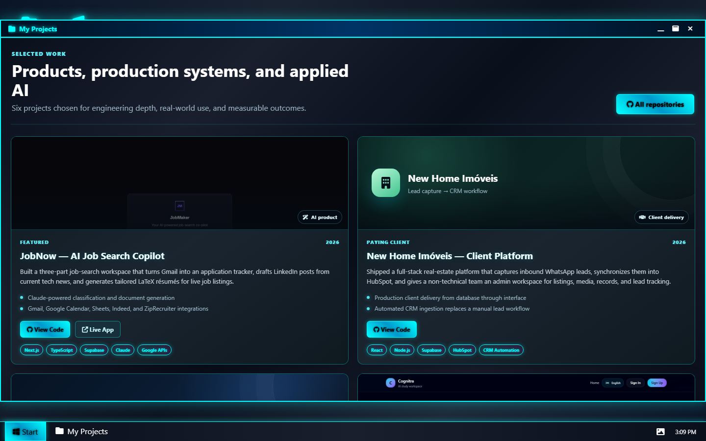

# João Vitor Barros da Silva — Portfolio

Interactive software-engineering portfolio presented as a Windows 11 desktop, with draggable application windows, a searchable Start menu, a working terminal, and customizable wallpaper.

[Live portfolio](https://joao-vitor-barros-da-silva-portfoli.vercel.app) · [Recruiter quick view](https://joao-vitor-barros-da-silva-portfolio.vercel.app/recruiter.html) · [GitHub profile](https://github.com/jvitorbarros15) · [LinkedIn](https://www.linkedin.com/in/joao-vitor-barros-da-silva)



## Highlights

- Recruiter-focused project cards with live demos, source links, stack summaries, and engineering outcomes
- One-click recruiter view with experience, measurable impact, selected projects, résumé, and contact details
- Windows-style Start menu with search, keyboard navigation, and quick links
- Draggable, resizable, minimizeable, and maximizeable windows
- Built-in terminal commands and interactive desktop customization
- Responsive layout with accessible controls and reduced-motion support
- Downloadable résumé and direct email contact

## Featured work

| Project | Focus | Demo |
| --- | --- | --- |
| JobNow | AI job-search workflows, Google integrations, Supabase | [Open](https://jobnow-lime.vercel.app) |
| New Home Imóveis | Real-estate discovery and administration | [Open](https://new-home-imoveis.vercel.app) |
| Meridian Invest | Next.js, FastAPI, PostgreSQL, Redis, Docker | Local setup |
| Cognitra | AI study tools, transcription, Firebase | [Open](https://cognitra.vercel.app) |
| ZorAI | AI-image provenance, Solidity, IPFS, Base Sepolia | [Open](https://zorai.vercel.app) |

## Run locally

No application build step is required.

```bash
python -m http.server 8080
```

Open <http://localhost:8080>.

## Structure

```text
index.html       Desktop, windows, and portfolio content
recruiter.html   Fast-scanning recruiter overview
css/style.css    Windows-inspired interface and responsive states
css/recruiter.css Recruiter-view layout and responsive styles
js/script.js     Window manager, Start menu, terminal, and interactions
img/projects/    Project previews
files/           Downloadable résumé
docs/            Repository preview assets
```

## Verification

After content or interaction changes, test desktop and mobile layouts, keyboard navigation, the Start menu, project links, résumé download, and browser-console output.

Built with semantic HTML, modern CSS, and vanilla JavaScript to keep the portfolio fast and dependency-light.
